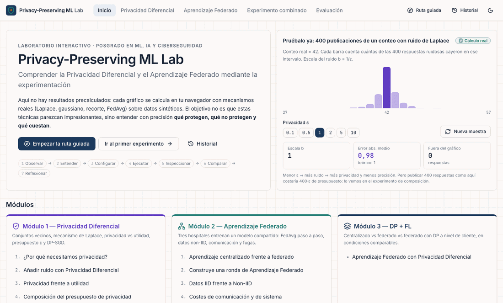

# Privacy-Preserving ML Lab

*Understanding Differential Privacy and Federated Learning through experimentation.*

An interactive, fully client-side teaching lab for postgraduate students in Machine Learning, AI and Cybersecurity. Students change parameters, run real simulations in the browser, inspect intermediate computations and compare runs. The aim is to understand **what Differential Privacy (DP) and Federated Learning (FL) protect, what they do not protect, and the trade-offs involved**. The goal is not to make these techniques look impressive.



*Demo (recorded from the production build, all values computed live in the browser): overview with a live Laplace sampler → Laplace mechanism step by step and repeated releases → centralised vs federated workflow → FedAvg round inspector → Centralised vs FL vs FL+DP comparison (ε shown only when the accountant applies) → knowledge check with per-option feedback.*

> **Resumen en español.** Laboratorio educativo interactivo (React + TypeScript) sobre Privacidad Diferencial y Aprendizaje Federado. Todo el contenido de la aplicación está en español. Se ejecuta íntegramente en el navegador, usa solo datos sintéticos, no necesita claves de API ni servidor, y funciona sin conexión una vez instaladas las dependencias. Cada experimento separa los cálculos reales, las garantías formales (bajo supuestos), las observaciones empíricas, los modelos simplificados y las ilustraciones conceptuales. Instalación: `npm install` y después `npm run dev`.

---

## Quick start

Requirements: **Node.js ≥ 18** (developed with Node 26 / npm 11).

```bash
npm install        # install dependencies (only network access ever needed)
npm run dev        # start the dev server → http://localhost:5173
npm test           # run the unit tests (Vitest)
npm run build      # type-check (tsc -b) and build the production bundle into dist/
npm run preview    # serve the production build locally
```

- No API keys, paid services or backend.
- No student data leaves the browser. Experiment history lives only in `localStorage`, and JSON/Markdown exports are generated client-side.
- Fonts are bundled from local `@fontsource` packages, so the app works offline after `npm install`.

---

## Architecture

```
src/
├── lib/                      # Computation engine: pure, strictly typed, unit-tested, UI-free
│   ├── rng/rng.ts            # Seeded PRNG (Mulberry32), Box–Muller normal, inverse-CDF Laplace, crypto RNG
│   ├── stats.ts  vec.ts      # mean/std/quantile/histogram/CI, vector ops, L2 clipping
│   ├── dp/
│   │   ├── laplace.ts        # Laplace mechanism, pdf/cdf, repeated simulation, privacy-loss function
│   │   ├── sensitivity.ts    # count / bounded sum / bounded mean sensitivities + stated assumptions
│   │   ├── composition.ts    # sequential-composition budget ledger, repeated-release experiment
│   │   ├── accountant.ts     # RDP accountant for composed Gaussian mechanism (no subsampling)
│   │   └── dpsgd.ts          # SGD vs DP-SGD for logistic regression with per-step traces
│   ├── ml/logistic.ts        # logistic regression, per-example gradients, SGD, synthetic blobs
│   ├── fl/
│   │   ├── data.ts           # synthetic "hospital" clients, IID / non-IID generation, global test set
│   │   ├── fedavg.ts         # FedAvg, DP-FedAvg (client-level), centralised baseline, round traces
│   │   ├── communication.ts  # payload-only communication-cost model
│   │   └── leakage.ts        # analytic gradient-inversion illustration for logistic regression
│   ├── tasks.ts              # Expensive sweeps/comparisons, all pure functions (the "backend boundary")
│   ├── useSimTask.ts         # React hook: runs a task in a Web Worker, falls back to the main thread
│   ├── store.ts              # shared persistent state (memory + localStorage) via useSyncExternalStore
│   ├── runs.ts  report.ts    # experiment runs/history, JSON export, Markdown educational report
│   ├── router.ts             # tiny hash router (#/dp/2), works offline without a server
│   └── glossary.ts           # Spanish glossary used by <Term> tooltips
├── workers/sim.worker.ts     # Web Worker that dispatches TASKS by name
├── components/
│   ├── ui/                   # shadcn/ui-style primitives built on Radix (button, slider, tabs, tooltip…)
│   ├── lab/                  # ExperimentLayout, IntegrityBadge, ParamControl, ShowCalculations,
│   │                         # RunTimeline, Reflection, ProsCons, Callout, Term…
│   └── charts/               # ChartFrame (accessible chart + "Ver datos" table), Recharts theme
├── modules/
│   ├── registry.ts           # experiment catalogue, routes and lazy-loaded pages
│   ├── overview/  journey/   # landing page and guided 7-stage learning journey
│   ├── dp/                   # Module 1: five DP experiments
│   ├── fl/                   # Module 2: five FL experiments
│   ├── combined/             # Module 3: centralised vs FL vs FL+DP
│   ├── quiz/                 # knowledge checks per module and the final practical challenge
│   ├── history/              # saved experiments, comparison, export
│   └── limits/               # "Lo que esta simulación NO demuestra"
└── test/                     # Vitest unit tests for the engine
```

**Stack:** React 18 + TypeScript (strict) + Vite 5, Tailwind CSS 3, shadcn/ui-style components on Radix primitives, Recharts, Framer Motion, Lucide icons, Vitest.

### Adding a Python backend later

The engine is split from the UI on purpose. Every expensive computation is a pure function in `src/lib/tasks.ts`, registered by name in `TASKS` and called through `runSimTask(name, payload)` (`src/lib/useSimTask.ts`). To add a backend (real ML training with PyTorch/Opacus, or advanced accounting with Google's `dp-accounting`):

1. Implement the same task names behind an HTTP endpoint (e.g. `POST /tasks/{name}`) that accepts and returns the same JSON-serialisable shapes (`TaskInput<K>` / `TaskOutput<K>`).
2. In `runSimTask`, route selected tasks to `fetch` instead of the worker.

Components stay unchanged. Under the project's privacy rules, any backend must be self-hosted and opt-in.

---

## Experiment catalogue

Every experiment uses the same layout: **Configuration** (left), **Interactive visualisation** (centre), **Observations** (right), and an **Experiment timeline** (bottom) for replaying, comparing, renaming, saving and exporting runs. Below that come **Ver cálculos** (equations, inputs, intermediate values, assumptions, outputs), benefits/limitations and a reflection question.

| Route | Experiment | What is actually computed |
|---|---|---|
| `/dp/1` | Why do we need privacy? | Exact count/mean on a fictional 5-person dataset, and on neighbouring datasets (remove/replace a target individual), shown side by side. |
| `/dp/2` | Laplace mechanism | True count, noisy release `count + Lap(1/ε)`, noise, absolute error, and the distribution over N seeded repetitions against the theoretical density. |
| `/dp/3` | Privacy vs utility | Empirical mean absolute error vs ε (with variability), release distributions for neighbouring datasets, privacy-loss ratio ≤ e^ε, bounded-mean sensitivity `(U−L)/n` and clamping bias. |
| `/dp/4` | Budget composition | Sequential-composition ledger with limit and over-budget warnings; one release vs the average of k releases (total cost k·ε). |
| `/dp/5` | DP-SGD | Logistic regression with SGD vs DP-SGD: per-example gradients, clipping, Gaussian noise, updates, loss/accuracy curves. ε is shown only when the implemented accountant applies (full batch); otherwise **"No calculado"**. |
| `/fl/1` | Centralised vs federated | Animated side-by-side flows of raw data vs model updates for three synthetic hospitals. |
| `/fl/2` | A FedAvg round | Step-by-step FedAvg (init → selection → local training → transmission → weighted aggregation → evaluation). All parameters come from the live simulation. |
| `/fl/3` | IID vs non-IID | Same FedAvg configuration under both data regimes, over repeated seeds: global accuracy, per-client accuracy, convergence and loss, with variability. |
| `/fl/4` | Communication costs | Bytes per round and in total; a grid over local epochs × participation measuring the rounds, bytes and gradient evaluations needed to reach a target test loss (default) or accuracy; extrapolation to larger reference models. |
| `/fl/5` | Privacy limits of FL | Analytic gradient inversion for logistic regression (exact for one example, residual-weighted mean for a batch), optionally with noise. Includes a conceptual panel on secure aggregation, DP and TEEs/access control. |
| `/combined` | FL with DP | Centralised vs FedAvg vs client-level DP-FedAvg under the same data, seed and test set; accuracy/loss, communication and compute overhead, update norms, clipping fraction; σ × C sweep (privacy–utility); conceptual secure-aggregation mode. |
| `/quiz/{dp,fl,combined}` | Knowledge checks | 5 applied-reasoning questions per module, each option with its own explanation. Numeric questions are computed with the engine functions. |
| `/quiz` | Final challenge | Three fictional organisations (hospital network, mobile keyboard, statistics agency) with explicit accuracy, privacy and communication requirements; rule-based feedback per requirement (meets / partially / fails) plus a reasoned discussion. |
| `/journey` | Guided journey | Seven stages from "the privacy problem" to "final decision". Experiment state persists as you move between stages. |

## Methodology and scientific integrity

Each experiment follows **Observe → Understand → Configure → Execute → Inspect → Compare → Reflect**. A concrete example comes first, then the notation.

Results carry an integrity label:

| Label | Meaning |
|---|---|
| **Cálculo real** | Computed live in the browser from the current parameters. Nothing is precomputed. |
| **Simulación educativa** | Real mechanisms in a deliberately simplified setting (tiny model, synthetic data). |
| **Garantía formal bajo supuestos** | A proven bound that holds only if every listed assumption holds. |
| **Observación empírica** | Measured over seeded repetitions. Depends on data and configuration. Not a guarantee. |
| **Ilustración conceptual** | A visual explanation, not an implementation or a measurement. |
| **No calculado** | No valid method is implemented for this configuration, so no number is shown. |

The lab never invents metrics or ε values. Seeded randomness is labelled as a reproducibility feature, not as private randomness.

---

## Mathematical assumptions

**Laplace mechanism.** `M(D) = f(D) + Lap(b)` with `b = Δf / ε` gives pure ε-DP when Δf is the true global L1 sensitivity: `P[M(D) ∈ S] ≤ e^ε · P[M(D′) ∈ S]` for all neighbouring D, D′ and all sets S. E|noise| = b and sd = √2·b. The guarantee is distributional. It does not promise that each individual release looks similar.

**Neighbouring datasets and sensitivity** (`src/lib/dp/sensitivity.ts`):
- Count, add/remove one person: Δ = 1 (each person appears at most once).
- Bounded sum on `[L, U]`, add/remove: Δ = max(|L|, |U|). With replacement: Δ = U − L.
- Bounded mean, replacement neighbours, public n: **Δ = (U − L) / n**. Values are clamped to public bounds chosen independently of the data. Clamping can introduce bias.

**Sequential composition.** Running ε₁,…,ε_k-DP mechanisms on the same data costs at most Σεᵢ. The budget ledger refuses queries that would exceed the limit. Changing the seed never refunds budget.

**DP-SGD** (`src/lib/dp/dpsgd.ts`), per step: (1) per-example gradients `(σ(θᵀx̃) − y)·x̃`; (2) clip each to L2 norm C: `g·min(1, C/‖g‖)`; (3) sum; (4) add `N(0, σ²C²·I)`; (5) divide by the public batch size B and update. Batches come from per-epoch shuffling, which is not Poisson sampling.

**Privacy accountant** (`src/lib/dp/accountant.ts`). Each step is a Gaussian mechanism with L2 sensitivity C and noise multiplier σ, so its RDP is `α/(2σ²)`. T adaptive steps compose to `Tα/(2σ²)`. Conversion to (ε, δ)-DP (Mironov 2017):

```
ε(δ) = min_{α>1}  T·α / (2σ²)  +  ln(1/δ) / (α − 1)
```

This bound is valid but conservative. It is computed **only** when every protected unit is in every step:
- DP-SGD with full batch (B = n).
- DP-FedAvg with 100 % client participation.

With mini-batches or partial participation, a tight bound needs subsampling amplification (e.g. a Poisson-subsampled Gaussian accountant), which is not implemented. The UI shows **"No calculado"** and gives the reason. σ = 0 also shows "No calculado". The bound further assumes ideal Gaussian sampling with secure randomness, which the lab's seeded PRNG is not.

**FedAvg** (`src/lib/fl/fedavg.ts`). `m = max(1, round(p·K))` clients are sampled per round with a seeded RNG. Each runs E local epochs of mini-batch SGD from the global model. Aggregation: `w_global = Σ_k (n_k / N)·w_k`, where N is the total number of samples among **participating** clients.

**DP-FedAvg (client-level DP, central model).** The privacy unit is the **whole client**. Each client delta `Δ_k = w_k − w_global` is clipped to norm C. The server, which must be trusted to add the noise, computes `w_global + (Σ clip(Δ_k) + N(0, σ²C²·I)) / m`, an *unweighted* mean so that sensitivity stays C. Record-level DP and distributed noise under secure aggregation are discussed but not implemented.

**Synthetic federated data** (`src/lib/fl/data.ts`). Two 2-D Gaussian classes centred at ±(1, 1) with unit sd, labelled "Biomarcador A/B" and "riesgo alto/bajo".
- IID: every client has p(y=1) = 0.5 and no shift.
- Synthetic data (`generateBlobs`): two Gaussian classes in 2D sharing an **anisotropic, correlated covariance** (axis SDs 1.6·sd and 0.55·sd, rotated ≈26°) with class means `m ± (1, 1)` around a non-zero midpoint `m = (0.8, −0.6)`. The mean-difference direction is therefore *not* the Bayes-optimal boundary `Σ⁻¹(μ₁ − μ₀)` and the bias must be learned, so training needs several iterations to converge (Bayes-level accuracy ≈ 0.86). That makes the effects of noise, heterogeneity and communication visible.
- Non-IID: label skew `p_k = 0.5 + 0.45·imbalance·t_k` with `t_k ∈ [−1, 1]`; covariate shift of magnitude `featureShift` in a client-specific direction; optional geometric size skew.
- The fixed global test set is a balanced mixture of all clients' distributions.

**Communication model** (`src/lib/fl/communication.ts`). Per round: `m × P × 4 bytes` down plus the same up (float32 parameters only). Headers, encryption, compression, retries, latency and bandwidth asymmetry are excluded. The lab model has P = 3.

**Centralised baseline.** Pooled SGD for `rounds × local epochs` epochs with the same learning rate, batch size, data and test set.

---

## Limitations (what this lab does **not** demonstrate)

The in-app page `/limits` has the full list. In summary:

- **Seeded PRNG is not secure.** Mulberry32 is for reproducibility only. Real DP deployments need cryptographically secure randomness.
- **Floating-point issues.** Naive floating-point Laplace/Gaussian sampling can leak through low-order bits (Mironov 2012). Production libraries use snapping or discrete sampling; this lab does not.
- **Conservative ε, no subsampling amplification.** Formal ε is shown only in full-batch / full-participation modes.
- **Unaccounted tuning.** Hyper-parameter tuning on private data also leaks information and is not accounted for here.
- **Simulated FL.** Clients are simulated in-browser: no network, dropouts, stragglers, malicious or Byzantine clients.
- **Toy model.** The model is a 3-parameter logistic regression. Deep, non-convex models behave differently.
- **Leakage illustration is not an attack.** Gradient inversion here is an analytic illustration on a linear model, not a full reconstruction attack such as DLG.
- **Secure aggregation is conceptual.** No cryptographic protocol is implemented.
- **Non-IID is not always worse.** IID vs non-IID outcomes depend on the synthetic generator.
- **Out of scope.** Membership inference on the final model, poisoning, and regulatory compliance (GDPR, HIPAA) are not evaluated.
- **Data.** All data is fictional and synthetic.

---

## Testing

```bash
npm test
```

Vitest suites in `src/test/` and `src/modules/quiz/` cover:
- **RNG:** reproducibility, uniform/normal moments, Laplace mean/variance/E|X|/quantiles, invalid scales.
- **DP:** `b = Δ/ε` and its monotonicity in ε, input validation, empirical MAE → b, the privacy-loss bound ≤ ε, sensitivities (including a randomized check that the bounded mean changes by at most Δ), sequential composition and over-budget refusal, repeated-release averaging, RDP accountant vs closed form, and its monotonicity in σ and T.
- **ML / DP-SGD:** analytic vs finite-difference gradients, L2 clipping, learning on synthetic data, clipped norms ≤ C, empirical noise sd ≈ σC, reproducibility, and ε computed only when valid.
- **FL:** exact weighted FedAvg aggregation (also inside a full round), client selection, reproducible data, non-IID label skew, size skew, convergence, invalid configs, DP-FedAvg clipping and update rule, accounting applicability, communication totals matching the simulation.
- **Tasks:** utility sweep monotonicity and reproducible comparisons.
- **Quiz:** exactly one correct option per question, explanations for every option, scoring, and reference answers passing the final challenge.

## Data storage and export

- Parameters, results, reflections and quiz progress are stored under `pml:*` keys in `localStorage` only. Clearing site data resets the lab.
- Each run is logged in the experiment timeline. Star a run to keep it in **Historial** (`/history`), where runs can be renamed, annotated, compared, and exported as **JSON** (parameters + results) or as a concise **Markdown educational report**. The report includes experiment name, parameters, seed, results, mathematical assumptions, any established privacy guarantee, limitations and student observations.
- All exports are created in the browser with `Blob` downloads. Nothing is uploaded.

## Accessibility

- **Semantics and keyboard:** semantic landmarks, a skip link, `aria-current` navigation and keyboard-operable controls (Radix primitives, native radio groups in quizzes).
- **Charts:** each chart has a text description and a **"Ver datos"** toggle that reveals the underlying data table.
- **Feedback and tooltips:** quiz and challenge feedback is announced through `aria-live`. Glossary tooltips are reachable by keyboard.
- **Theming and motion:** light theme by default with an optional dark mode, honours `prefers-reduced-motion`, and the layout works at desktop and tablet widths.
